# Jibli.tn - Architecture Documentation

> **Outdated:** this describes the earlier Express + static HTML version, which is now legacy.
> The current design is in [../tech/system-design.md](../tech/system-design.md).

**Last Updated:** 2026-01-26  
**Version:** 1.0.0

---

## System Architecture Overview

Jibli.tn follows a **three-tier architecture** pattern with clear separation between presentation, business logic, and data layers.

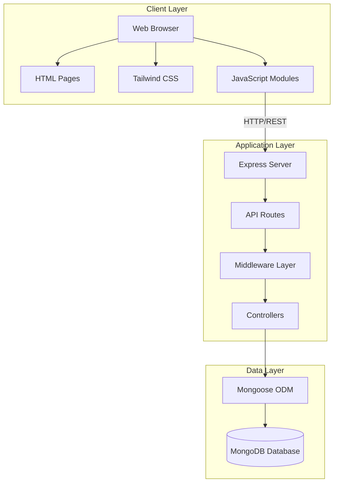

---

## Component Architecture

### Frontend Architecture

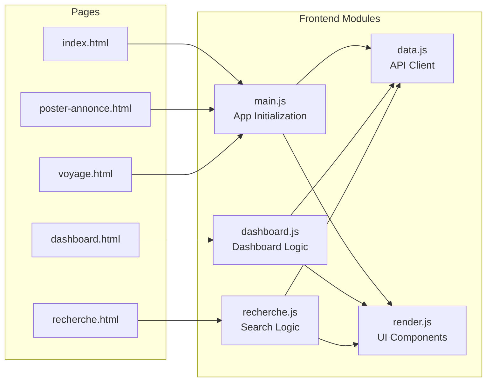

**Key Responsibilities:**
- **main.js:** Event handling, form submissions, authentication flow
- **data.js:** API communication, JWT token management, state
- **render.js:** HTML generation, UI component rendering
- **dashboard.js:** User dashboard logic, trip/request management
- **recherche.js:** Search and filter logic

---

### Backend Architecture

```mermaid
graph TB
    subgraph "API Layer"
        AuthRoute[/api/auth]
        TripsRoute[/api/trips]
        RequestsRoute[/api/requests]
        UsersRoute[/api/users]
    end
    
    subgraph "Middleware Layer"
        AuthMW[Auth Middleware<br/>JWT Verification]
        ValidMW[Validation Middleware<br/>Input Validation]
        ErrorMW[Error Middleware<br/>Error Handling]
    end
    
    subgraph "Controller Layer"
        AuthCtrl[Auth Controller<br/>Login/Register]
        TripCtrl[Trip Controller<br/>CRUD Operations]
        ReqCtrl[Request Controller<br/>CRUD Operations]
    end
    
    subgraph "Model Layer"
        UserModel[User Model<br/>Mongoose Schema]
        TripModel[Trip Model<br/>Mongoose Schema]
        RequestModel[Request Model<br/>Mongoose Schema]
    end
    
    AuthRoute --> AuthMW
    TripsRoute --> AuthMW
    RequestsRoute --> AuthMW
    UsersRoute --> AuthMW
    
    AuthMW --> ValidMW
    ValidMW --> AuthCtrl
    ValidMW --> TripCtrl
    ValidMW --> ReqCtrl
    
    AuthCtrl --> UserModel
    TripCtrl --> TripModel
    ReqCtrl --> RequestModel
    
    AuthCtrl --> ErrorMW
    TripCtrl --> ErrorMW
    ReqCtrl --> ErrorMW
```

---

## Data Flow Diagrams

### Authentication Flow

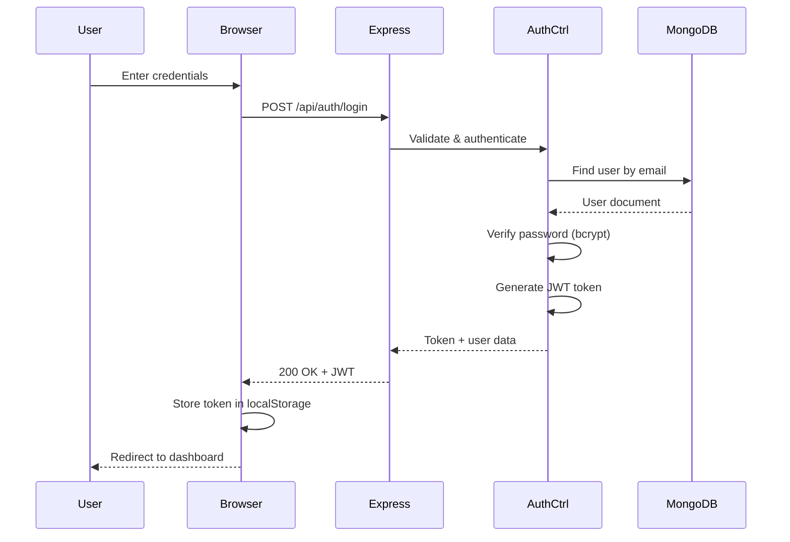

### Trip Creation Flow

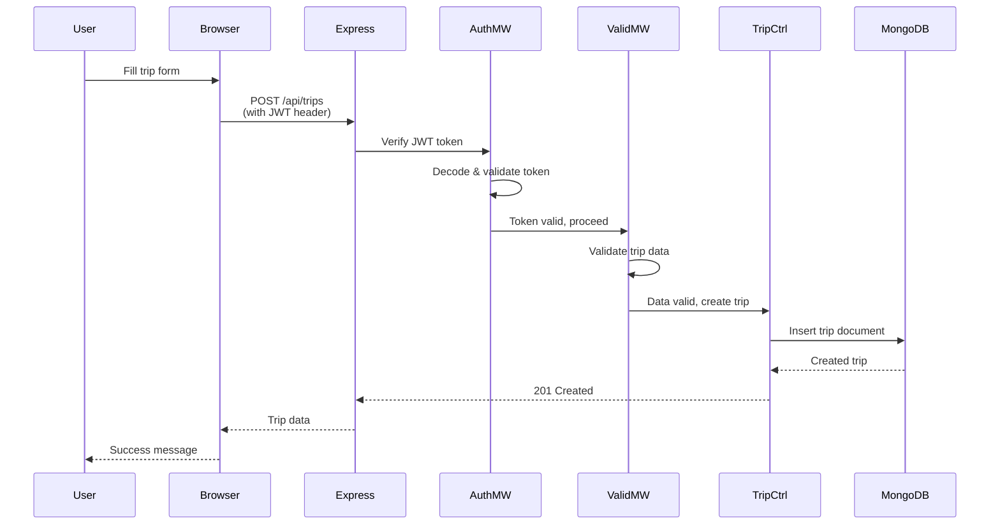

### Search Flow

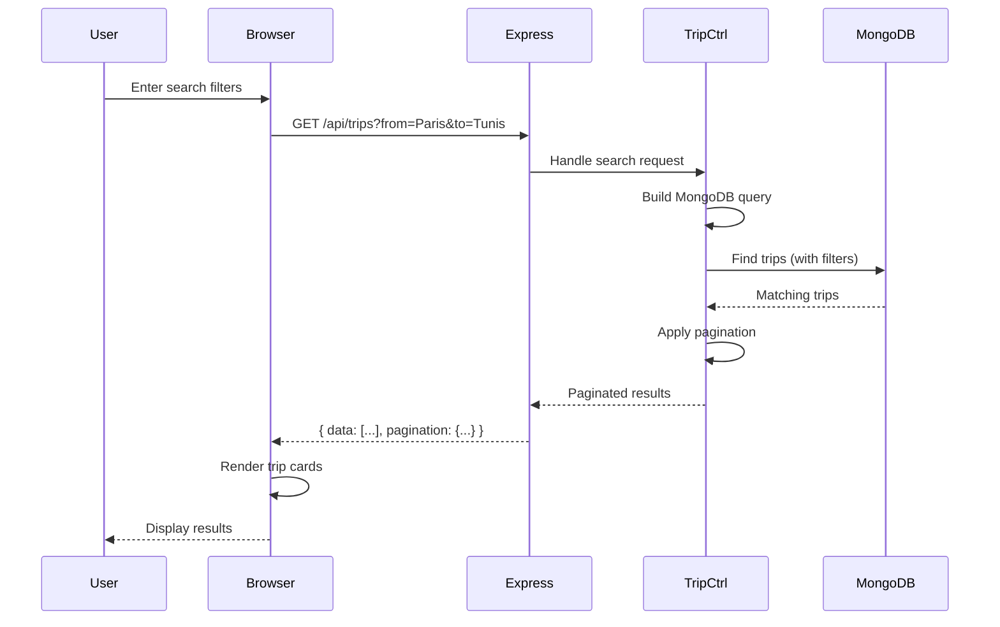

---

## Database Schema

### Entity Relationship Diagram

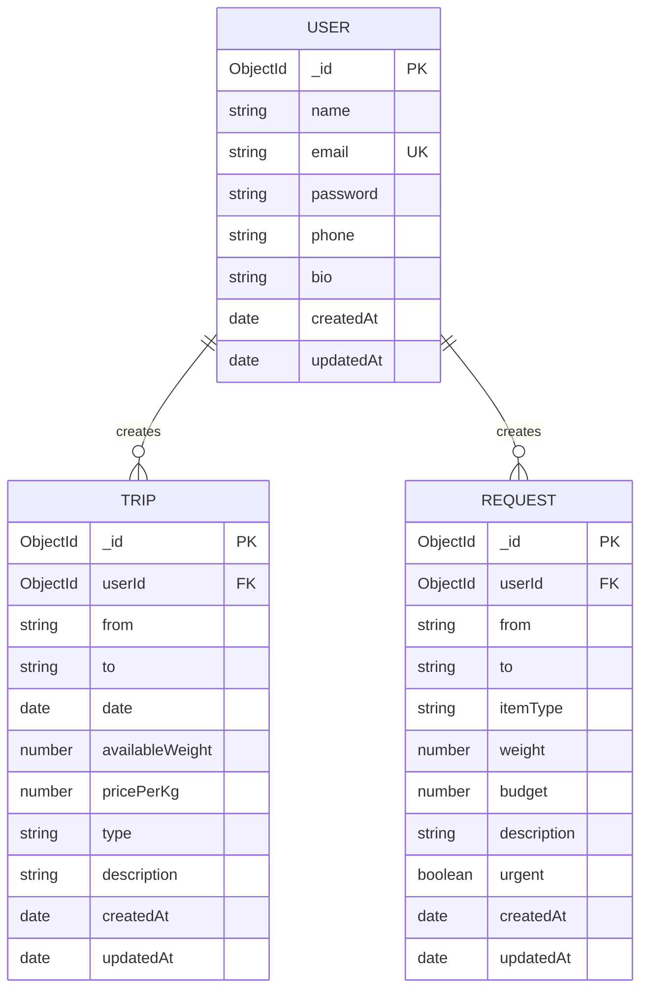

---

## Security Architecture

### Authentication & Authorization Flow

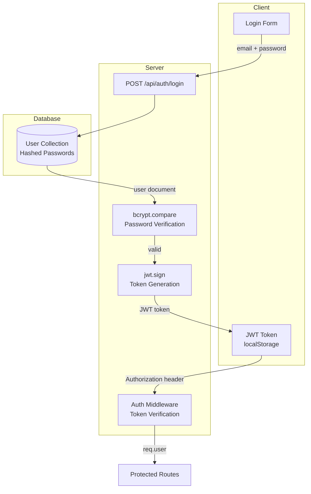

**Security Measures:**
- **Password Hashing:** bcrypt with 10 salt rounds
- **Token-based Auth:** JWT with 7-day expiration
- **Stateless Sessions:** No server-side session storage
- **Protected Routes:** Middleware verification on sensitive endpoints
- **Input Validation:** Middleware validation before controller execution

---

## Deployment Architecture

### Development Environment

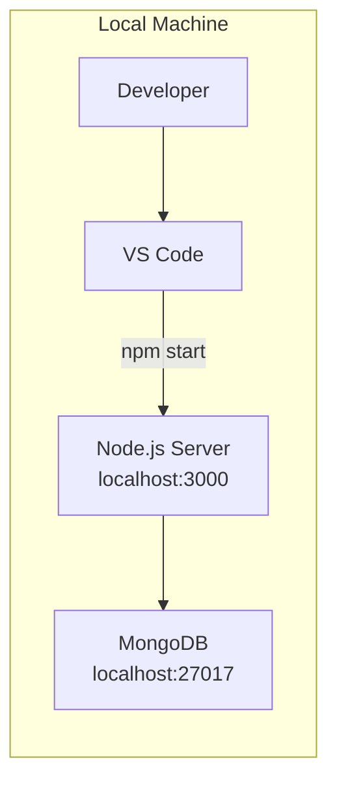

### Production Environment (Recommended)

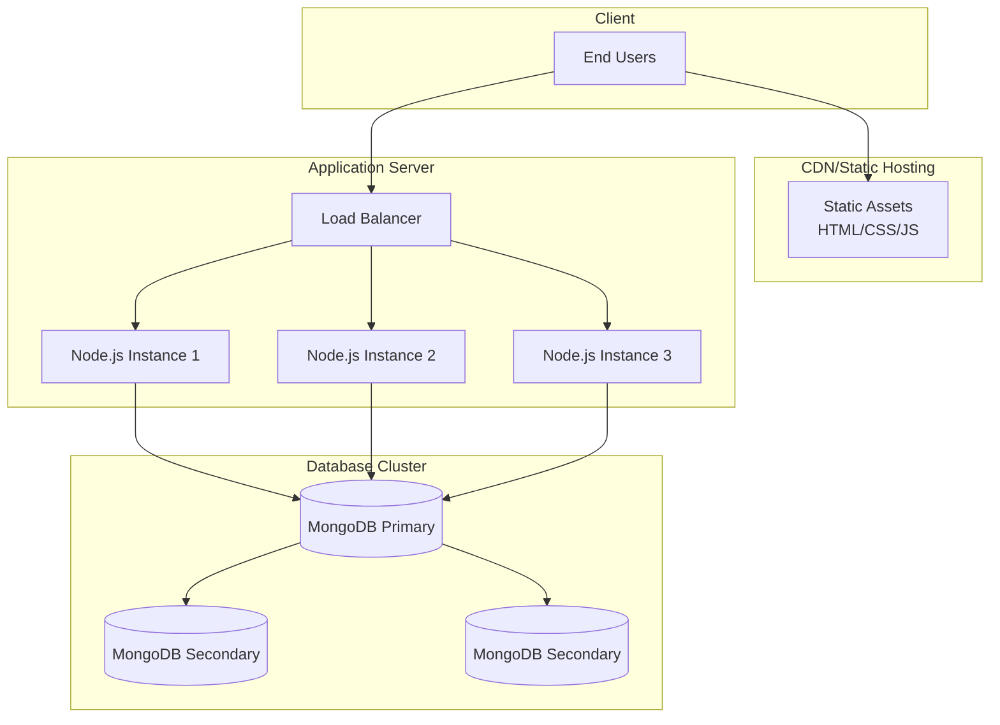

---

## Technology Stack Diagram

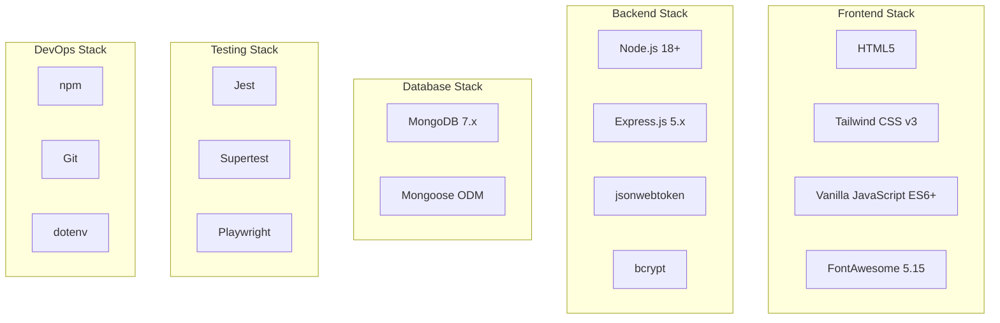

---

## API Architecture

### RESTful Endpoint Structure

```
/api
├── /auth
│   ├── POST /register          # Create new user
│   └── POST /login             # Authenticate user
│
├── /trips
│   ├── GET /                   # List trips (with filters)
│   ├── GET /:id                # Get single trip
│   ├── POST /                  # Create trip (auth required)
│   ├── PUT /:id                # Update trip (auth required)
│   └── DELETE /:id             # Delete trip (auth required)
│
├── /requests
│   ├── GET /                   # List requests (with filters)
│   ├── GET /:id                # Get single request
│   ├── POST /                  # Create request (auth required)
│   ├── PUT /:id                # Update request (auth required)
│   └── DELETE /:id             # Delete request (auth required)
│
└── /users
    ├── GET /:id                # Get user profile
    ├── PUT /:id                # Update profile (auth required)
    └── DELETE /:id             # Delete account (auth required)
```

### Request/Response Flow

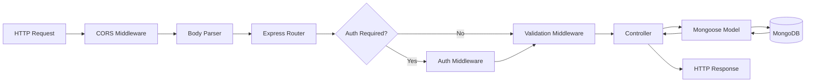

---

## File Organization

```
Jibli.tn code/
│
├── Frontend Layer
│   ├── pages/              # HTML views
│   ├── js/                 # Client-side logic
│   ├── css/                # Stylesheets
│   └── assets/             # Static assets
│
├── Backend Layer
│   ├── routes/             # API endpoints
│   ├── middleware/         # Request processing
│   ├── controllers/        # Business logic
│   ├── models/             # Data schemas
│   └── config/             # Configuration
│
├── Testing Layer
│   ├── tests/integration/  # API tests
│   ├── tests/e2e/          # UI tests
│   └── */**.test.js        # Unit tests
│
├── Documentation Layer
│   └── docs/               # Project documentation
│
└── Configuration
    ├── server.js           # Entry point
    ├── package.json        # Dependencies
    ├── jest.config.js      # Test config
    └── .env                # Environment vars
```

---

## Scalability Considerations

### Current Architecture (MVP)
- **Single Server:** One Node.js instance
- **Single Database:** One MongoDB instance
- **Suitable for:** 100-1000 concurrent users

### Phase 2 (Growth)
- **Horizontal Scaling:** Multiple Node.js instances behind load balancer
- **Database Replication:** MongoDB replica set (1 primary, 2 secondaries)
- **Caching Layer:** Redis for session management and frequent queries
- **Suitable for:** 10,000+ concurrent users

### Phase 3 (Scale)
- **Microservices:** Separate services for auth, trips, messaging
- **Database Sharding:** Distributed MongoDB across regions
- **CDN:** Static asset delivery via CloudFlare/AWS CloudFront
- **Message Queue:** RabbitMQ/Kafka for async operations
- **Suitable for:** 100,000+ concurrent users

---

## Performance Optimization

### Current Optimizations
- **Database Indexing:** Indexes on frequently queried fields (email, userId)
- **Pagination:** Limit results to 20 items per page
- **JWT Stateless:** No server-side session storage
- **Static Asset Serving:** Express static middleware

### Planned Optimizations
- **Query Optimization:** Mongoose lean() for read-only operations
- **Response Compression:** gzip middleware
- **Rate Limiting:** Prevent API abuse
- **Image Optimization:** Compress and resize uploaded images
- **Database Connection Pooling:** Reuse connections

---

## Monitoring & Logging (Planned)

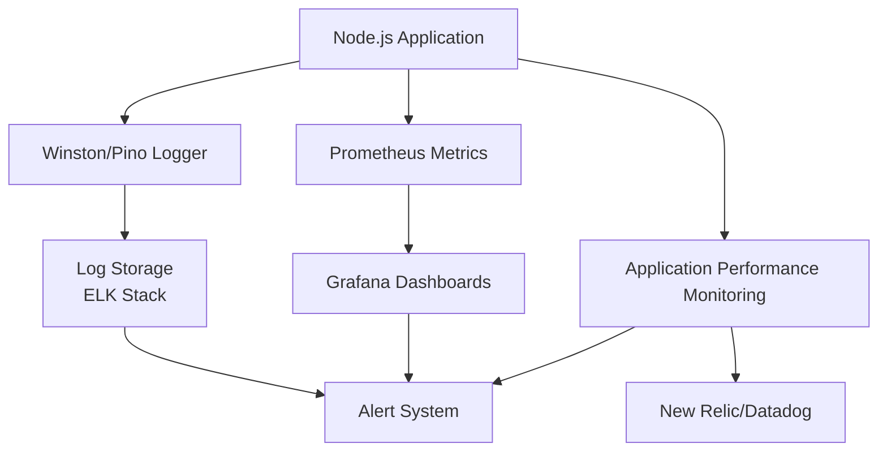

---

## References

- [Express.js Best Practices](https://expressjs.com/en/advanced/best-practice-performance.html)
- [MongoDB Schema Design](https://www.mongodb.com/docs/manual/core/data-modeling-introduction/)
- [JWT Authentication](https://jwt.io/introduction)
- [RESTful API Design](https://restfulapi.net/)
