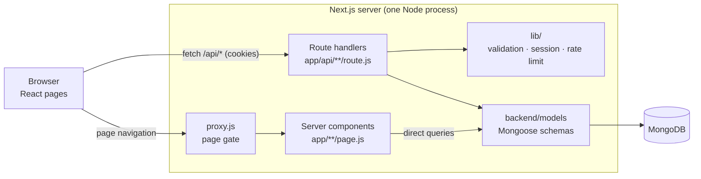
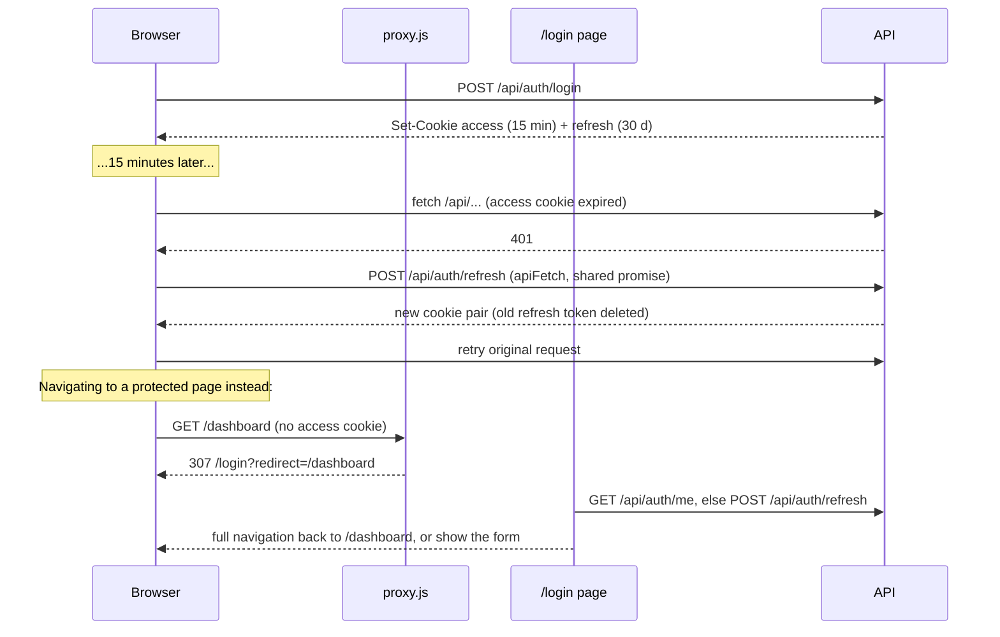
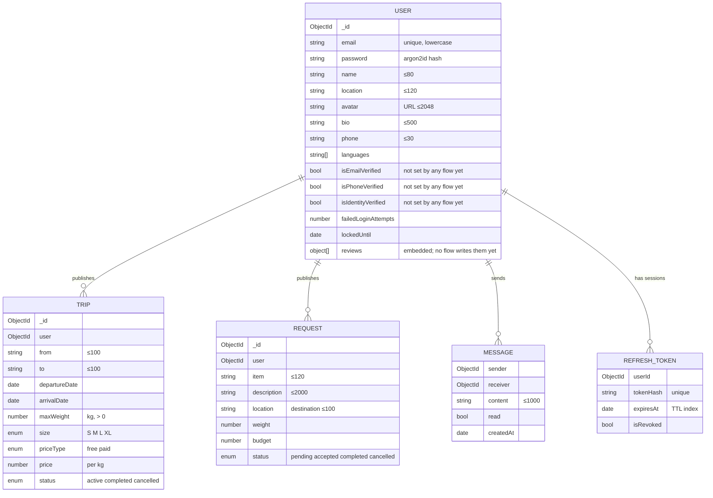

# Jibli.tn — System Design

**Status:** current as of 2026-11-07. This is the reference description of how the application works today.
It supersedes `docs/functionnal/architecture.md`, which describes the earlier Express + static HTML version.
The prioritised list of what to change next is in [improvement-plan.md](improvement-plan.md).

---

## 1. What the product does

Jibli.tn is a peer-to-peer crowd-shipping marketplace between the Tunisian diaspora and Tunisia:

- **Travellers** publish *trips* (route, date, spare luggage weight, free or paid).
- **Senders** publish *requests* (an item to bring to a destination, optional weight and budget).
- Either side finds the other through search, then they agree on details through **direct messages**.

The platform only puts people in touch. It does not handle payment, transport or delivery
confirmation, and it has no reviews or identity checks yet (the data model reserves fields for them).

---

## 2. Big picture

The live application is **one Next.js 16 (App Router) app** that serves both the React pages and a
JSON API from the same process, backed by **MongoDB** through **Mongoose**.



Two ways data reaches the screen:

1. **Server-rendered pages** (home, trip/request detail, public profile, legal pages) query MongoDB
   directly through the models and send finished HTML. Good for SEO and first paint.
2. **Client pages** (`'use client'`: search, dashboard, messages, posting, profile settings, login,
   register) render in the browser and call the JSON API with `fetch`, sending the session cookies.

### Legacy code still in the repository

The previous version is still present and still runs with `npm start`:
`server.js` (Express), `backend/routes`, `backend/controllers`, `backend/middleware(s)`, `pages/*.html`,
`js/`, `css/`. The Next app does **not** use any of it except `backend/models` and `backend/config/db.js`.
The Jest integration tests exercise this legacy Express API, not the Next routes.
Retiring it is item P1-1 of the improvement plan.

---

## 3. Repository layout

```text
app/                    Next.js App Router
  layout.js             Root layout: fonts, Navbar, Footer
  page.js               Home (server component, rendered per request)
  recherche/            Search (client)
  voyage/[id]/          Trip detail (server)
  demande/[id]/         Request detail (server)
  profile/              Own profile settings (client, protected)
  profile/[id]/         Public profile (server)
  dashboard/            My trips and requests (client, protected)
  messages/             Conversations (client, protected)
  poster-annonce/       Publish a trip or request (client, protected)
  login/ register/      Auth forms (client)
  conditions/ confidentialite/ securite/   Static legal pages
  not-found.js error.js French 404 and crash pages
  api/                  JSON API (see §6)
components/             Navbar, Footer, LegalPage, ShareButton
lib/                    Shared server/client helpers (see §5)
proxy.js                Redirects anonymous users away from protected pages
backend/models/         Mongoose schemas (shared with the legacy server)
backend/config/db.js    Cached MongoDB connection
backend/seed.js         Demo data (wipes the target database first)
tests/e2e/              Playwright: API + browser tests of the Next app
tests/integration/      Jest + Supertest: legacy Express API
tests/unit/             Jest unit tests
docs/                   Functional specs (functionnal/) and technical docs (tech/)
```

---

## 4. Request lifecycle

### Pages

1. `proxy.js` runs first for `/dashboard`, `/profile` (exactly), `/messages`, `/poster-annonce`.
   If the `access_token` cookie is missing it redirects to `/login?redirect=<path+query>`.
   It only checks presence; the API verifies the token itself.
2. Server pages call `connectDB()` and query models directly, convert the result to plain JSON and
   render. Pages that list changing data use `export const dynamic = 'force-dynamic'` so they are
   never frozen at build time.
3. Client pages fetch the API through `apiFetch` (see §5.4).

### API routes

Every route handler follows the same shape:

```text
rate limit (where relevant) → connectDB() → authenticate (getAuthenticatedUser)
→ parse body (readJson) → whitelist fields (pick) → validate (lib/validation)
→ authorise (owner check) → Mongoose call (runValidators on updates)
→ JSON response; errors through handleApiError
```

Conventions:

| Situation | Response |
|---|---|
| Not logged in / token expired | `401 { error }` — the client then tries a refresh |
| Logged in but not the owner | `403 { error }` |
| Malformed or unknown id | `404 { error }` |
| Invalid input | `400 { error: 'Données invalides', details: [French messages] }` |
| Duplicate key | `409 { error }` |
| Too many attempts | `429 { error }` + `Retry-After` |
| Anything else | `500 { error }`, logged server-side |

---

## 5. Shared modules (`lib/`)

| Module | Runs on | Responsibility |
|---|---|---|
| `api.js` | server | `isValidId`, `readJson`, `pick` (field whitelist), `containsFilter` (escaped, case-insensitive search), `parsePagination` (default 20, max 100), `validationFailed`, `handleApiError` |
| `validation.js` | server | Password policy, `validateTrip`, `validateRequest` (full for POST, `partial` for PUT), `startOfToday` |
| `session.js` | server | JWT secret handling, token issue/rotation (`startSession`), cookie clearing |
| `rateLimit.js` | server | In-memory fixed-window limiter and per-endpoint quotas |
| `clientApi.js` | browser | `apiFetch` (refresh-and-retry on 401), `refreshSession`, `clearLocalSession`, `safeRedirectPath` |
| `reviews.js` | both | `averageRating` (null when there are no reviews) |

---

## 6. API reference

All bodies are JSON. 🔒 = needs a valid `access_token` cookie.

### Auth

| Method | Path | Notes |
|---|---|---|
| POST | `/api/auth/register` | `{ email, password, name }`. Password: ≥12 chars with lower, upper, digit, special. Rate limited per IP. |
| POST | `/api/auth/login` | `{ email, password }` → sets cookies, returns `{ user: { id, email, name } }`. Locks the account 15 min after 10 failures. Rate limited per IP. |
| POST | `/api/auth/refresh` | Uses the `refresh_token` cookie; rotates both tokens. |
| POST | `/api/auth/logout` | Deletes the refresh token server-side and clears cookies. |
| GET | `/api/auth/me` 🔒 | `{ user: { id, email } }` from the access token. |
| PUT | `/api/auth/password` 🔒 | `{ oldPassword, newPassword }`; signs out every other session. |

### Listings

| Method | Path | Notes |
|---|---|---|
| GET | `/api/trips` | Filters: `from`, `to` (contains), `date` (departs on/after), `minWeight`, `priceType`, `size`, `user`, `page`, `limit`. Without `user`: only `active` trips departing today or later. |
| POST | `/api/trips` 🔒 | `from, to, departureDate, maxWeight` required; `arrivalDate, size, priceType, price` optional. Departure cannot be in the past. |
| GET | `/api/trips/:id` | Owner populated with public fields only. |
| PUT / DELETE | `/api/trips/:id` 🔒 | Owner only. PUT accepts the POST fields plus `status`; cannot change the owner. |
| GET | `/api/requests` | Filters: `query` (item/description), `location`, `maxBudget`, `user`, paging. Without `user`: only `pending`. |
| POST | `/api/requests` 🔒 | `item, location` required; `description, weight, budget` optional. |
| GET / PUT / DELETE | `/api/requests/:id` | Same rules as trips. |

List responses: `{ data: [...], pagination: { total, page, limit, pages } }`.

### Users and messages

| Method | Path | Notes |
|---|---|---|
| GET | `/api/users/:id` | Public profile. `email` and `phone` are added only when you request your own. |
| PUT | `/api/users/:id` 🔒 | Self only. Editable: `name, location, bio, phone, languages, avatar`. |
| GET | `/api/messages/conversations` 🔒 | Latest message per partner; partner limited to `_id, name, avatar, location`. |
| GET | `/api/messages/:userId` 🔒 | Thread with that user, oldest first. |
| PUT | `/api/messages/:userId/read` 🔒 | Marks messages from that user as read. |
| POST | `/api/messages` 🔒 | `{ receiverId, content }` (≤1000 chars, not to yourself). Rate limited per user. |

### Platform

| Method | Path | Notes |
|---|---|---|
| GET | `/api/stats` | Counts of trips, requests, users. |
| GET | `/api/health` | `200 { status: 'ok' }` when MongoDB answers, else `503`. |

---

## 7. Authentication and sessions

Two cookies, both `HttpOnly`, `SameSite=Strict`, `Secure` in production:

| Cookie | Content | Lifetime | Path |
|---|---|---|---|
| `access_token` | JWT `{ id, email }` signed with `JWT_SECRET` | 15 min | `/` |
| `refresh_token` | 64 random bytes; only its SHA-256 is stored (`RefreshToken` collection) | 30 days, single use | `/api/auth` |

The refresh cookie is limited to `/api/auth` so it is only sent to refresh, logout and password
change. `localStorage` holds `jibli_logged_in` and `jibli_user_name` purely for display (navbar);
it is never trusted for access.



Other rules:

- Passwords are hashed with Argon2id (64 MB, t=3, p=4). Unknown emails are checked against a dummy
  hash so login time does not reveal which accounts exist.
- After a successful login the page does a **full navigation** (`window.location`), because the
  client router may hold a prefetch of the target made while logged out.
- Production refuses to start signing tokens without a private `JWT_SECRET` of ≥32 characters.

---

## 8. Data model



Indexes: `Trip {status, departureDate}`, `Trip {user, departureDate}`, `Request {status, createdAt}`,
`Request {user, createdAt}`, `Message {sender, receiver}` / `{receiver, sender}` / `{createdAt}`,
`RefreshToken {expiresAt}` (TTL), `User.email` and `RefreshToken.tokenHash` (unique).

JSON output includes both `_id` and the `id` virtual. The frontend reads `_id`; `id` remains for
the legacy frontend.

---

## 9. Pages

| Route | Rendering | Access | Data |
|---|---|---|---|
| `/` | server, per request | public | 3 upcoming active trips, 4 newest pending requests |
| `/recherche?type=trips\|requests` | client | public | `/api/trips`, `/api/requests`, `/api/stats` |
| `/voyage/:id`, `/demande/:id` | server | public | model query; 404 page if missing |
| `/profile/:id` | server | public | user public fields + active trips |
| `/login`, `/register` | client | public | auth API |
| `/dashboard` | client | protected | `/api/trips?user=me`, `/api/requests?user=me` |
| `/poster-annonce?type=trip\|request` | client | protected | POST trips/requests |
| `/messages?userId=` | client | protected | messages API, polls the open thread every 3 s |
| `/profile` | client | protected | users API, password API |
| `/conditions`, `/confidentialite`, `/securite` | static | public | — |

---

## 10. Security controls

| Threat | Control |
|---|---|
| Password theft from the DB | Argon2id |
| Token theft via XSS | HttpOnly cookies; React escaping; CSP |
| CSRF | `SameSite=Strict` cookies, JSON bodies |
| Session replay after logout | refresh tokens are server-side, single use, deleted on logout |
| Brute force | per-account lockout; per-IP limits on login/register; per-user limits on password change and messages |
| Mass assignment | every write goes through a field whitelist (`pick`) |
| Injection / ReDoS | ids checked as ObjectIds, search input escaped, non-string bodies rejected |
| Data exposure | owner details populated with public fields only; email/phone only to their owner |
| Clickjacking, sniffing | `X-Frame-Options: DENY`, `frame-ancestors 'none'`, `nosniff`, `Referrer-Policy`, no `X-Powered-By` |
| Open redirect | `safeRedirectPath` only allows same-site paths |

Known gaps are listed in the improvement plan (shared rate-limit store, CSP nonces, email verification).

---

## 11. Configuration

| Variable | Required | Purpose |
|---|---|---|
| `MONGO_URI` | yes (defaults to local `jibli`) | MongoDB connection string |
| `JWT_SECRET` | yes in production (≥32 random chars) | signs access tokens |
| `PORT` | no | legacy Express server only; Next uses `-p` |
| `NODE_ENV` | set by Next | `production` enables `Secure` cookies and strict secret checks |

`.env` is git-ignored. `.env.example` only contains placeholders.

---

## 12. Testing

| Layer | Tool | Scope | Command |
|---|---|---|---|
| Unit | Jest | `lib/rateLimit.js`, legacy controllers and middleware, legacy frontend modules | `npm test` |
| Integration | Jest + Supertest + in-memory MongoDB | legacy Express API | `npm test` |
| End-to-end | Playwright | Next.js API (`api.spec.js`) and browser flows (auth, search, listings, messaging) | `npm run test:e2e` |

The E2E suite builds the app and runs it on port 3100 against an in-memory MongoDB seeded by
`backend/seed.js` (`tests/e2e/test-server.js`), so no real database is touched.

---

## 13. Visual design

Brand tokens come from `docs/tech/Graphical_chart.json` and are mapped in `tailwind.config.js`:

| Token | Tailwind | Use |
|---|---|---|
| Blue `#0F4C81` | `primary` (`hover`, `light`) | main actions, links, headers |
| Amber `#F59E0B` | `accent` | secondary call to action |
| Tunisian red `#C1121F` | `identity-tunisian-red` | logo only, never for errors |
| Status colours | `state-success/warning/error/info` | feedback |
| Greys | `neutral-50…950` | text, borders, backgrounds |

Typography: Inter, self-hosted through `next/font`. Icons: `lucide-react`.
UI language: French only. The page `lang` is `fr`.

---

## 14. Conventions for contributors

- New API routes reuse `lib/api.js` helpers: whitelist with `pick`, validate, return French
  `details`, let `handleApiError` map Mongoose errors.
- Dynamic route params are a Promise in Next 16: `const { id } = await params`.
- Any route that populates `user` imports `backend/models/User` so the schema is registered.
- Client code calls the API with `apiFetch`, never bare `fetch`, for anything that needs a session.
- Server pages listing live data export `dynamic = 'force-dynamic'`.
- Add an E2E test for every user-visible flow and an `api.spec.js` case for every API rule.
